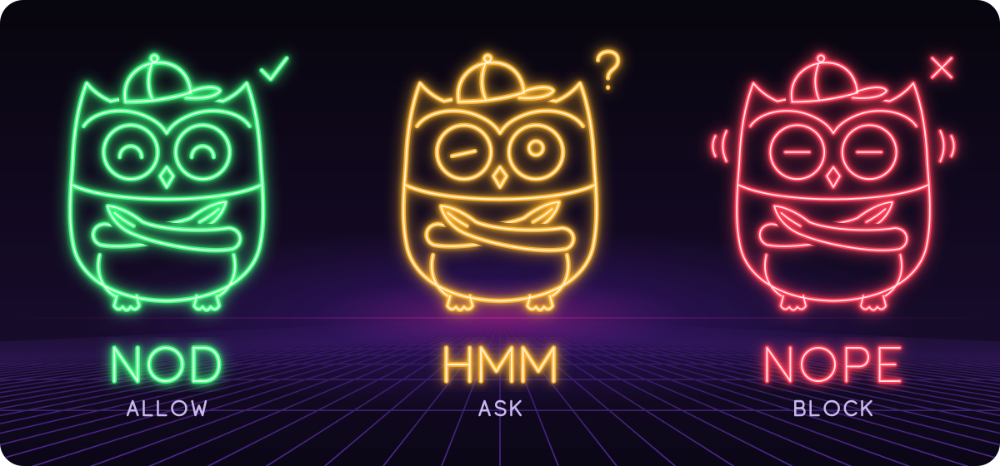
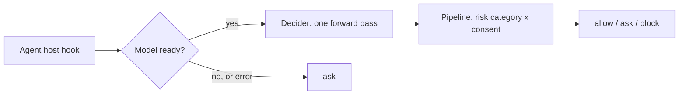

<p align="center">
  <picture>
    <source media="(prefers-color-scheme: dark)" srcset="assets/logo-dark.svg">
    
  </picture>
</p>

<h3 align="center">Your agent asks. Nod answers.</h3>

<p align="center">
  <b>Auto mode and auto review for AI coding agents.</b> Before your agent runs a shell command, Nod answers <b>allow</b>, <b>ask</b> or <b>block</b>: so safe calls run on their own, risky ones stop for you, and you get fewer permission prompts without giving up control.
</p>

<p align="center">
  
  
  
</p>

---

Nod is an **auto mode** (an auto-approve layer that lets routine calls through) with an **auto review** (a reviewer model that checks each risky call) for agent hosts such as Claude Code, Hermes, Pi and OpenCode. A local [Decider](#credits) model judges every call in context, **including what you told the agent**, not just the command. There is no allow list in the default path. When the model isn't ready, Nod answers **ask**, never allow.

**Docs:** [Install](INSTALL.md) · [How it works](docs/HOW_IT_WORKS.md) · [Agent review](docs/AGENT_REVIEW.md) · [Audit trail](docs/AUDIT.md) · [Model tiers](docs/MODEL_TIERS.md) · [Models and llama.cpp](docs/MODELS_AND_LIBS.md) · [GPU](docs/GPU.md) · [Hosts](docs/HOSTS.md) · [Config](docs/CONFIG.md) · [Privacy](docs/PRIVACY.md) · [CLI JSON](docs/CLI_OUTPUTS.md) · [Exit codes](docs/EXIT_CODES.md) · [FAQ](docs/FAQ.md)

## Three answers

<p align="center">
  
</p>

| | Verdict | `nod check` exit | In Claude Code (enforce mode) |
|---|---|:---:|---|
| **Nod** | `allow` | 0 | The call runs without a prompt. |
| **Hmm** | `ask` | 1 | Claude Code asks you, as usual. |
| **Nope** | `block` | 2 | The call is denied, with the reason. |

In **shadow** mode, the default, Nod only logs its verdicts and your host's own permission flow stays in charge. Exit 1 always means a real `ask`; usage errors exit 64. All codes: [docs/EXIT_CODES.md](docs/EXIT_CODES.md).

## Demo

```console
$ nod check -- ls -la
allow
$ nod check -- scp backup.tar.gz deploy@192.0.2.10:/srv/
block
$ nod check -- dd if=/dev/zero of=/dev/sda
block
$ echo $?
2
$ nod check --json -- dd if=/dev/zero of=/dev/sda
{
  "decision": "block",
  "source": "model",
  "tier": "?",
  "reason": "model",
  "model_ran": true,
  "p_allow": 0.0413,
  "p_ask": 0.1366,
  "p_block": 0.8221,
  "p_auth": 0.0843,
  "p_forbid": 0.9965,
  "category": "deleting or overwriting data outside the project, discarding git history or changes, force-pushing, or dropping databases",
  "ms": 1954
}
```

Captured against a server running the `lite` model on a GPU: about 2 s for the last call; the first call after idle also loads the model. `scp` to a host the conversation never mentioned is stopped: with no conversation context, an unexplained copy is treated as a risk. The JSON adds the model's probabilities (`p_allow`, `p_ask`, `p_block`, and the consent scores). Field reference: [docs/CLI_OUTPUTS.md](docs/CLI_OUTPUTS.md).

## Why

- **One judge, no allow list.** The model judges the whole call in context, where pattern lists have gaps. About 2 s per call on `lite`; an optional `hybrid` engine adds rules in front.
- **Everything is auditable.** Every action Nod sees goes into a persistent, hash-chained audit trail with the command and the decision; `nod audit verify` shows if anything in the middle was altered. See [Audit trail](#audit-trail).
- **It reads the conversation.** Approved by you: allow. Forbidden by you: block. See [below](#it-reads-the-conversation).
- **Local by default.** The Decider runs on your machine through llama.cpp, and tool calls go to `127.0.0.1` unless you point Nod at your own server. With `--model agent` the review goes to the model your agent already uses instead ([privacy](docs/PRIVACY.md)).
- **Fails safe.** A cold, slow or broken model never turns into an allow: the answer is ask.
- **Installs safe.** Every install prints its full plan, backs up host config first, and can be rolled back.

## Install

```sh
go install github.com/MQ37/nod/cmd/nod@latest      # Go 1.25 or newer; pure Go, no cgo
nod skill install                                   # puts the setup skill where Claude Code finds it
```

Then tell your agent: **"set up nod"**. Nod does not download llama.cpp or models itself. The skill asks you which host, which model size, local or remote, fetches llama.cpp and the model with checksums, then runs `nod install`, which only writes configuration, the user service and the hook. By hand: `nod skill print`. Once the model and libraries exist, the install itself is one command:

```sh
nod install --model fast --model-path ~/.local/share/nod/models/fast/decider-4b-v2.1-Q4_K_M.gguf \
  --llama-lib-dir ~/.local/share/nod/llama/bin --host claude
```

It prints every file and config diff and asks before changing anything. It runs as your user (systemd `--user` or launchd, no root) and starts in shadow mode. When the verdicts in `nod decisions` look right: `nod config set mode enforce`. To remove what Nod wrote: `nod uninstall --yes`. `go install` puts `nod` in `$(go env GOPATH)/bin` (usually `~/go/bin`); make sure that is on your `PATH`. Building from source, agent-driven and remote installs: [INSTALL.md](INSTALL.md), [docs/FAQ.md](docs/FAQ.md).

## Audit trail

Every action is recorded, across reboots, one file per host in `~/.local/state/nod/audit/`: time, host, tool, the command (redacted), its sha256, the decision and why, and the session. Each line carries the hash of the line before it.

```sh
nod decisions -n 20 -v     # recent verdicts from every host, with commands
nod audit verify           # exits 4 if a line was changed, removed or reordered
```

Calls a host plugin sees but Nod does not judge are recorded as `unchecked`. The trail holds commands (secrets redacted), so keep the directory private; `audit_commands` stores less. Fields, limits and what the chain does not prove: [docs/AUDIT.md](docs/AUDIT.md).

## Model tiers

| Tier | Model | Size | RAM | Stop rate | Model call under load |
|---|---|---:|---|---:|---:|
| `fast` | Decider-4B, Q4_K_M | 2.7 GB | ≥ 8 GB | 19.5% | 1.65 s |
| `lite` | Decider-12B (Gemma-4-12B-it base), Q8_0 | 12.7 GB | ≥ 24 GB | 16.5% | 4.7 s |
| `full` | Decider-35B-A3B, Q8_0 | 36.9 GB | ≥ 64 GB and a GPU | 17.0% | 2.3 s |

Measured with the `hybrid` engine on one sample of 200 real tool calls; not a guarantee. `nod models list` shows what to fetch; `nod models verify DIR --tier fast` checks a directory against the published checksums. More numbers: [docs/MODEL_TIERS.md](docs/MODEL_TIERS.md). Downloads: [docs/MODELS_AND_LIBS.md](docs/MODELS_AND_LIBS.md). GPU: [docs/GPU.md](docs/GPU.md).

## Auto review with the agent's own model

No GPU or local model? On Hermes and OpenCode, Nod can ask **the model your agent already runs** to review each call, with the same questions and consent rules as the Decider. It costs one extra request per reviewed call on the agent's own account, and any failure means ask. Claude Code and Pi are not supported in this mode. A model reviewing its own session is a weaker check than an independent Decider. Details: [docs/AGENT_REVIEW.md](docs/AGENT_REVIEW.md).

```sh
nod install --model agent --host hermes        # or: --host opencode
```

## It reads the conversation

| What you said | `git push --force origin feature/login` |
|---|---|
| nothing relevant | **block** |
| "I rebased my feature/login branch, force push it to origin please" | **allow**, approved |
| "Do not push anything to the remote, I want to review first" | **block**, forbidden |

Your approval can turn a risky call into an allow, but not an irreversible one; your prohibition always wins. Only your own messages count: tool output, file contents and web pages never reach the consent questions. More: [docs/HOW_IT_WORKS.md](docs/HOW_IT_WORKS.md#it-reads-the-conversation).

## How it works



1. **Decider.** One forward pass answers typed questions (risk category, did you ask for it, did you forbid it); no text is generated.
2. **Pipeline.** A small deterministic matrix turns the probabilities into allow, ask or block.
3. **Fail-safe.** The model loads on first use; a cold call waits at most 5 seconds, then answers ask. Details and the `hybrid` engine: [docs/HOW_IT_WORKS.md](docs/HOW_IT_WORKS.md); settings: [docs/CONFIG.md](docs/CONFIG.md).

## Supported hosts

| Host | Status | Wiring ([details and removal](docs/HOSTS.md)) |
|---|---|---|
| Claude Code | install, shadow or enforce | `PreToolUse` hook in `~/.claude/settings.json`, merged after a backup. Matcher `Bash` by default, 15 s timeout. |
| Hermes | install | `nod-gate` plugin; enable it with `hermes plugins enable nod-gate`. |
| Pi / Oh My Pi | install | Extension that calls the service's `/decide` endpoint. |
| OpenCode | install, shadow or enforce | Plugin in `~/.config/opencode/plugins/` (or `plugin/`); gates `bash`. In enforce mode ask and block fail the call. Untested against a running OpenCode. |

## Limits

- **Not a sandbox.** Code running as your user, including the agent, can edit Nod's binary, config, service or hooks. Run untrusted agents in a container or VM and keep secrets out of their reach.
- **A classifier, not a proof.** The model is probabilistic, and a clever prompt injection or an unfamiliar command can fool it. Coverage is limited to the adapters above and the configured matcher.
- **No auth or TLS on the HTTP service.** Bind it to loopback or a private network.
- **CPU runtime unless you build for your GPU.** See [docs/GPU.md](docs/GPU.md).

## Development

```sh
bash ./build.sh deps    # once: download the pinned Go modules (the only networked step)
bash ./build.sh test    # go vet ./... and go test ./...
bash ./build.sh build   # dist/nod-linux-amd64, nod-linux-arm64, nod-darwin-arm64
```

Everything runs offline in rootless Podman, nothing on the host. Package map, parity rules and golden data: [docs/DEVELOPMENT.md](docs/DEVELOPMENT.md).

## Credits

**Decider models** by [Mapika](https://huggingface.co/Mapika), Apache-2.0: [decider-4b-GGUF](https://huggingface.co/Mapika/decider-4b-GGUF), [decider-12b](https://huggingface.co/Mapika/decider-12b) and [decider-35b-a3b](https://huggingface.co/Mapika/decider-35b-a3b). Nod's readout follows decider-ai 1.8.0. The model work is theirs; Nod is the gate around it. **[llama.cpp](https://github.com/ggml-org/llama.cpp)** (MIT) runs the model, called through [jupiterrider/ffi](https://github.com/jupiterrider/ffi) and [ebitengine/purego](https://github.com/ebitengine/purego). No cgo.

## License

MIT, see [LICENSE](LICENSE). Third-party components and model terms are listed in [NOTICE](NOTICE).
