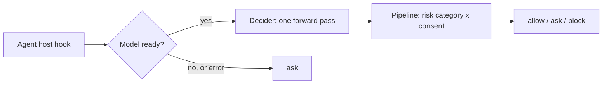

<p align="center">
  <picture>
    <source media="(prefers-color-scheme: dark)" srcset="assets/logo-dark.svg">
    
  </picture>
</p>

<h3 align="center">Your agent asks. Nod answers.</h3>

<p align="center">
  <b>Auto mode and auto review for AI coding agents.</b> Before your agent runs a shell command, Nod answers <b>allow</b>, <b>ask</b> or <b>block</b>: so safe calls run on their own, risky ones stop for you, and you get fewer permission prompts without giving up control.
</p>

<p align="center">
  
  
  
  
</p>

---

Nod is an **auto mode** (an auto-approve layer that lets routine calls through) with an **auto review** (a reviewer model that checks each risky call) for agent hosts such as Claude Code, Hermes, Pi and OpenCode. It sits between the host and the tools it calls. A local [Decider](#credits) model judges every call: it reads a typed decision from one forward pass (no text is generated), **and it reads what you told the agent**, not just the command. There is no allow list in the default path. A call runs because the model judged it safe in context, not because a pattern matched. When the model isn't ready, Nod answers **ask**, never allow.

## Three answers

<p align="center">
  
</p>

| | Verdict | `nod check` exit | In Claude Code (enforce mode) |
|---|---|:---:|---|
| **Nod** | `allow` | 0 | The call runs without a prompt. |
| **Hmm** | `ask` | 1 | Claude Code asks you, as usual. |
| **Nope** | `block` | 2 | The call is denied, with the reason. |

Exit 1 always means a real `ask`; usage errors exit 64, and exit 3 means the check itself failed, for example an unreadable config. An unreachable service is not an error: `check` returns the `on_unreachable` verdict (`ask` by default), sets `source` to `unreachable` and `error` in the JSON, and notes it on stderr, so you can tell it from a model verdict. In **shadow** mode, the default, Nod only logs its verdicts and your host's own permission flow stays in charge.

## Demo

```console
$ nod check -- ls -la
allow
$ nod check -- scp backup.tar.gz deploy@192.0.2.10:/srv/
block
$ nod check -- dd if=/dev/zero of=/dev/sda
block
$ echo $?
2
$ nod check --json -- dd if=/dev/zero of=/dev/sda
{
  "decision": "block",
  "source": "model",
  "tier": "?",
  "reason": "model",
  "model_ran": true,
  "p_allow": 0.0413,
  "p_ask": 0.1366,
  "p_block": 0.8221,
  "p_auth": 0.0843,
  "p_forbid": 0.9965,
  "category": "deleting or overwriting data outside the project, discarding git history or changes, force-pushing, or dropping databases",
  "ms": 1954
}
```

This run was captured against a server running the `lite` model on a GPU. It took about 2 s for the last call; the first call after idle also loads the model. `scp` to a host the conversation never mentioned is stopped; with no conversation context, an unexplained copy is treated as a risk. The JSON adds the model's probabilities (`p_allow`, `p_ask`, `p_block`, and the consent scores). Field reference: [docs/CLI_OUTPUTS.md](docs/CLI_OUTPUTS.md).

## Why

- **One judge, no allow list.** Shell parsing and pattern lists have gaps: a command that merely looks like `ls`, or a test run after a file was written. The model judges the whole call in context instead. The cost is a model call per tool call (about 2 s on the `lite` model). An optional `hybrid` engine adds deterministic tiers and rules in front; see [How it works](#how-it-works).
- **It reads the conversation.** The same command gets a different answer depending on what you said: approved by you, allow; forbidden by you, block. See [below](#it-reads-the-conversation).
- **Local.** The model runs on your machine through llama.cpp. Tool calls go to `127.0.0.1` unless you point Nod at your own server.
- **Fails safe, installs safe.** A cold, slow or broken model never turns into an allow: the answer is ask. Every install prints its full plan, backs up host config first, and can be rolled back.

## It reads the conversation

A command alone is not enough to judge it. `git push --force` is routine after you asked for it and a problem after you said not to. Nod passes the model your own recent messages (and the assistant text they replied to) and asks it two things: did the user explicitly ask for or approve exactly this action on exactly this target, and did the user tell the assistant not to do it? A deterministic matrix then combines that with how risky the call is.

Same command, three conversations (real output from the `lite` model, shown as `nod check`-style verdicts):

| What you said | `git push --force origin feature/login` |
|---|---|
| nothing relevant | **block** |
| "I rebased my feature/login branch, force push it to origin please" | **allow**, approved |
| "Do not push anything to the remote, I want to review first" | **block**, forbidden |

What this means in practice:
- Your approval can turn a risky call into an allow, but not an irreversible one: those still ask.
- Your prohibition always wins: a call you forbade is blocked.
- Only your own messages count. Tool output, file contents and web pages never reach the consent questions, so an injected "the user approved this" in fetched text cannot grant anything.
- No conversation, no consent: without context the model judges the call on its category alone.

Hosts supply the conversation automatically: the Claude Code adapter reads the session transcript, and the Hermes and Pi integrations send the user's turns from their own history. For manual checks, `nod check --task TEXT -- COMMAND` passes a task description, and the HTTP API accepts a full `conversation` array (see [docs/CLI_OUTPUTS.md](docs/CLI_OUTPUTS.md)). The messages go only to the server you configured; see [Privacy](#privacy).

## Install

Two steps: get the `nod` binary, then let an agent (or you) set it up.

```sh
go install github.com/MQ37/nod/cmd/nod@latest      # Go 1.25 or newer; pure Go, no cgo
nod skill install                                   # puts the setup skill where Claude Code finds it
```

Then tell your agent: **"set up nod"**. Nod does not download llama.cpp or models itself. The `nod` skill walks the agent through it: ask you the choices (which host, which model size, local or remote), fetch llama.cpp and the model with checksums, then run `nod install`, which only writes configuration, the user service and the hook. You can follow the same steps by hand: `nod skill print`.

`go install` puts `nod` in `$(go env GOPATH)/bin` (usually `~/go/bin`); make sure that is on your `PATH`. Prefer a prebuilt binary? Download it from a release, verify its published checksum and `install -m 755 nod-linux-amd64 ~/.local/bin/nod`. Or [build it](#development).

Once the model and libraries exist, the install itself is one command:

```sh
nod install --model fast --model-path ~/.local/share/nod/models/fast/decider-4b-v2.1-Q4_K_M.gguf \
  --llama-lib-dir ~/.local/share/nod/llama/bin --host claude
```

`nod install` prints every file and config diff it will apply and asks before changing anything. It runs as your user (systemd `--user` or launchd, no root) and starts in shadow mode. When the verdicts in `nod decisions` look right, switch to enforcement with `nod config set mode enforce`. `nod models list` shows what to fetch for each model size, and `nod models verify DIR --tier fast` checks a directory against the published checksums.

**Installing for someone else?** Agents get the same commands, non-interactively:

```sh
nod skill print                                                         # operator checklist (SKILL.md)
nod install --model fast --host claude --mode shadow --dry-run --json   # the plan, nothing applied
nod install --model fast --host claude --mode shadow --yes --json
nod doctor --json
```

A missing choice never blocks on input: the command exits 5 and prints the flag that answers it, such as `{"needs":[{"flag":"--yes","question":"execute the complete installation plan"}]}`. `nod skill install` copies the skill to `~/.claude/skills/nod/`. More: [INSTALL.md](INSTALL.md), [docs/EXIT_CODES.md](docs/EXIT_CODES.md).

**Laptop with a remote server?** Point Nod at the server and keep a small model as a backup: `nod install --model fast --remote http://192.0.2.10:11096 --host none --yes`. Calls go to the remote first and fall back to the local model if it is unreachable. The local model never loads while you are on battery (`nod config set local_power always` to allow it). Details: [INSTALL.md](INSTALL.md#remote-first-local-backup-battery-rule).

To remove everything Nod wrote (config, service, hooks): `nod uninstall --yes`. The model and libraries you fetched are yours to delete.

## Model tiers

| Tier | Model | Size and memory | Stop rate | SSH/SCP calls stopped | Auto-mode denials caught | Benign calls over-restricted | Model call under load |
|---|---|---|---:|---:|---:|---:|---:|
| `fast` | Decider-4B, Q4_K_M | 2.7 GB | 19.5% | 66.0% | 23 of 41 | 28 | 1.65 s |
| `lite` | Decider-12B (Gemma-4-12B-it base), Q8_0 | 12.7 GB, ≥ 24 GB RAM | 16.5% | 60.0% | 23 of 41 | 21 | 4.7 s |
| `full` | Decider-35B-A3B, Q8_0 | 36.9 GB, ≥ 64 GB RAM and a GPU | 17.0% | 61.3% | 22 of 41 | 8 | 2.3 s |

Measured with the `hybrid` engine on the same sample of 200 real tool calls that reached the model, with the same prompt and pipeline for every tier. One sample, not a guarantee.

**Model-only (the default) on the `lite` model**, on 286 synthetic calls with no conversation: it blocked all 195 commands the old block rules target and 48 of the 51 ask-rule commands (the other three were a harmless `$'\x41'`), but it stopped 13 of 40 routine calls that the tiers allow for free, such as `gh auth status` and `rm -rf node_modules`. Expect more prompts than `hybrid` and one model call per tool call. Total decision time differs from model-call time; see [docs/MODELS_AND_LIBS.md](docs/MODELS_AND_LIBS.md).

`fast` is a ready-made GGUF with published checksums. `lite` and `full` are published as safetensors; the skill has the agent convert them with llama.cpp's converter, so there is no published hash for the result (`nod models verify` shows its computed sha256 as `unpinned`). `nod models list --json` has every URL, size, checksum and conversion command.

## Using a GPU

The prebuilt llama.cpp release the skill suggests is the CPU build. To run on a GPU, build llama.cpp yourself (Vulkan, ROCm/HIP, CUDA or Metal) and point Nod at the directory that holds `libllama.so` (`libllama.dylib` on macOS):

```sh
nod config set llama_lib_dir /path/to/llama.cpp/build/bin
nod restart
```

Nod looks in this order: `NOD_LLAMA_LIB_DIR`, the `llama_lib_dir` setting, `/opt/llama.cpp/build/bin`, then its own data directory. `nod doctor` reports which one it found. Nod uses whatever backend that build was compiled with, and we have not verified Metal or GPU offload on macOS yet.

## Auto review with the agent's own model

No GPU, no download, no local model? Let the model your agent already runs do the review:

```sh
nod install --model agent --host hermes        # or: --host opencode
```

For Hermes and OpenCode the plugin runs inside the agent, so it can send one extra, separate request to **the same model the agent is using** (say, Opus in Hermes) instead of the Decider. Nod keeps the part that has to be consistent: its server builds the review prompt, the plugin asks the model, and Nod's pipeline turns the answers into allow, ask or block, with the same questions and the same consent rules as the Decider. There is no local model and no llama.cpp; `nod serve --model agent` is a tiny server that only builds prompts and applies the pipeline.

What to know before you turn it on:
- **It costs one extra request per reviewed call**, on the agent's own model and account, and adds its latency. Obviously read-only calls are not reviewed. With a large model that is real money; the Decider on a small local model is free after setup.
- **The reviewer sees only what the Decider sees:** the tool call (secrets redacted and clipped), the working directory, your own messages, and the assistant message each of them replies to. Never tool output or file contents. The review prompt tells the model that all of it is data to judge, not instructions.
- **A chat model answers with one choice, not probabilities.** A call you explicitly approved is allowed only if it is not in a block-class category; for those, Nod still asks, where the Decider can allow a clearly approved call. A model reviewing its own session is also a weaker check than an independent one: if you want a second opinion that the agent cannot influence, use a Decider.
- **Failure means ask**, never allow: an unreachable Nod server, a model error or timeout, or an unparsable answer.
- **Claude Code and Pi are not supported in this mode.** Their hooks run outside the agent and cannot reach its model; use a Decider model for them.
- OpenCode has no way for a plugin to raise a prompt, so "ask" tells the agent to get your explicit approval in plain words, and the next review sees it.

Per-host details and limits: [docs/HOSTS.md](docs/HOSTS.md).

## How it works



1. **Decider.** One forward pass answers a fixed set of typed questions: which risk category fits this call, did the user ask for it, did the user forbid it. Nod reads the answer probabilities from the logits. No text is generated.
2. **Pipeline.** A small deterministic matrix turns those probabilities into allow, ask or block. Context comes from the host transcript (recent user messages and the assistant text they reply to), never from tool output.
3. **Lazy load and fail-safe.** The model loads on first use and unloads after 15 idle minutes. A cold call waits at most 5 seconds, then answers ask while loading continues. An unreachable service gives the `on_unreachable` answer, `ask` by default.

**Optional `hybrid` engine.** `nod config set engine hybrid` (or `nod serve --engine hybrid`) puts a shell lexer and a finite rule set in front of the model. Read-only and routine local commands such as `ls` or `git commit` are then allowed without a model call, and block and ask rules label patterns such as raw-device writes or secret reads. It is faster and works when the model is down (block rules still block). It also trusts a hand-written parser: anything the lexer misjudges is allowed without review, and tests or build runners that execute project code pass as routine. That is why `model` is the default.

Settings: [docs/CONFIG.md](docs/CONFIG.md).

## Supported hosts

| Host | Status | Wiring |
|---|---|---|
| Claude Code | install, shadow or enforce | `PreToolUse` hook in `~/.claude/settings.json`, merged after a backup. Matcher `Bash` by default (`--matcher` changes it), 15 s timeout. Optional `SessionStart` warm-up hook. |
| Hermes | install | Embedded `nod-gate` plugin; enable it with `hermes plugins enable nod-gate`. |
| Pi / Oh My Pi | install | Embedded extension that calls the service's `/decide` endpoint. |
| OpenCode | install, shadow or enforce | Embedded plugin `nod.js` + `nod.json` in `~/.config/opencode/plugin/`; gates `bash`. An OpenCode plugin cannot open a prompt, so in enforce mode ask and block fail the call with a message. Untested against a running OpenCode. |

Details and removal: [docs/HOSTS.md](docs/HOSTS.md).

## Privacy

- **What a check sends:** tool name and input, working directory, task text and filtered conversation context, to the configured service (`127.0.0.1:11096` by default).
- **What is logged:** `decisions.jsonl` in `$XDG_RUNTIME_DIR/nod/`, mode 0600, with timestamps, host, tool, verdict, source, rule labels and timing. No command or conversation text. The Hermes and Pi integrations keep their own audit logs; Pi's records include up to 4,000 characters of tool input.
- **What leaves the machine:** nothing from Nod itself. It makes no network requests except to the server you configured. The model and llama.cpp downloads are done by you or your agent, with checksums, in the open.

Full details: [docs/PRIVACY.md](docs/PRIVACY.md).

## Limits

- **Not a sandbox.** Code running as your user, including the agent, can edit Nod's binary, config, service or hooks. Run untrusted agents in a container or VM and keep secrets out of their reach.
- **A classifier, not a proof.** The model is probabilistic, and a clever prompt injection or an unfamiliar command can fool it. Coverage is limited to the adapters above and the configured matcher.
- **Fail-safe means more prompts.** When the model is cold or down, Nod asks instead of guessing.
- **No auth or TLS on the HTTP service.** Bind it to loopback or a private network.
- **CPU runtime unless you build for your GPU.** The tested llama.cpp release (`b11714`) is the CPU build; see [Using a GPU](#using-a-gpu) and [docs/MODELS_AND_LIBS.md](docs/MODELS_AND_LIBS.md).
- **Set-up is a procedure, not a download.** The skill (or you) fetches llama.cpp and the model; a wrong or truncated file shows up in `nod models verify` and `nod doctor`.
- **No automatic enforcement.** Shadow mode stays on until you change it.

## Credits

- **Decider models** by [Mapika](https://huggingface.co/Mapika), Apache-2.0: [decider-4b-GGUF](https://huggingface.co/Mapika/decider-4b-GGUF), [decider-12b](https://huggingface.co/Mapika/decider-12b) and [decider-35b-a3b](https://huggingface.co/Mapika/decider-35b-a3b). Nod's readout follows decider-ai 1.8.0. The model work is theirs; Nod is the gate around it.
- **[llama.cpp](https://github.com/ggml-org/llama.cpp)** (MIT) runs the model, called through [jupiterrider/ffi](https://github.com/jupiterrider/ffi) and [ebitengine/purego](https://github.com/ebitengine/purego). No cgo.

## Development

Everything runs in rootless Podman, nothing on the host. Tests and builds are offline, with read-only source and scratch on tmpfs.

```sh
bash ./build.sh deps    # once: download the pinned Go modules (the only networked step)
bash ./build.sh test    # go vet ./... and go test ./...
bash ./build.sh build   # dist/nod-linux-amd64, nod-linux-arm64, nod-darwin-arm64
```

Package map and parity rules: [docs/DEVELOPMENT.md](docs/DEVELOPMENT.md). `testdata/golden/` comes from the reference implementation; do not hand-edit it.

## License

MIT, see [LICENSE](LICENSE). Third-party components and model terms are listed in [NOTICE](NOTICE).
