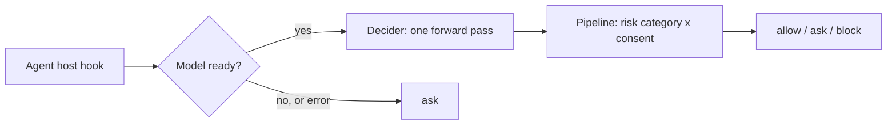

# How Nod works

Nod sits between an agent host (Claude Code, Hermes, Pi, OpenCode) and the tools it calls. A local Decider model judges every call: it reads a typed decision from one forward pass (no text is generated), and it reads what you told the agent, not just the command. There is no allow list in the default path. A call runs because the model judged it safe in context, not because a pattern matched. When the model isn't ready, Nod answers **ask**, never allow.

## The pipeline

1. **Decider.** One forward pass answers a fixed set of typed questions: which risk category fits this call, did the user ask for it, did the user forbid it. Nod reads the answer probabilities from the logits. No text is generated.
2. **Pipeline.** A small deterministic matrix turns those probabilities into allow, ask or block. Context comes from the host transcript (recent user messages and the assistant text they reply to), never from tool output.
3. **Lazy load and fail-safe.** The model loads on first use and unloads after 15 idle minutes. A cold call waits at most 5 seconds, then answers ask while loading continues. An unreachable service gives the `on_unreachable` answer, `ask` by default.

**Fail-safe means more prompts.** When the model is cold or down, Nod asks instead of guessing. A cold, slow or broken model never turns into an allow.

Settings: [CONFIG.md](CONFIG.md).

## One judge, no allow list

Shell parsing and pattern lists have gaps: a command that merely looks like `ls`, or a test run after a file was written. The model judges the whole call in context instead. The cost is a model call per tool call (about 2 s on the `lite` model).

## Optional `hybrid` engine

`nod config set engine hybrid` (or `nod serve --engine hybrid`) puts a shell lexer and a finite rule set in front of the model. Read-only and routine local commands such as `ls` or `git commit` are then allowed without a model call, and block and ask rules label patterns such as raw-device writes or secret reads. It is faster and works when the model is down (block rules still block). It also trusts a hand-written parser: anything the lexer misjudges is allowed without review, and tests or build runners that execute project code pass as routine. That is why `model` is the default.

## It reads the conversation

A command alone is not enough to judge it. `git push --force` is routine after you asked for it and a problem after you said not to. Nod passes the model your own recent messages (and the assistant text they replied to) and asks it two things: did the user explicitly ask for or approve exactly this action on exactly this target, and did the user tell the assistant not to do it? A deterministic matrix then combines that with how risky the call is.

Same command, three conversations (real output from the `lite` model, shown as `nod check`-style verdicts):

| What you said | `git push --force origin feature/login` |
|---|---|
| nothing relevant | **block** |
| "I rebased my feature/login branch, force push it to origin please" | **allow**, approved |
| "Do not push anything to the remote, I want to review first" | **block**, forbidden |

What this means in practice:
- Your approval can turn a risky call into an allow, but not an irreversible one: those still ask.
- Your prohibition always wins: a call you forbade is blocked.
- Only your own messages count. Tool output, file contents and web pages never reach the consent questions, so an injected "the user approved this" in fetched text cannot grant anything.
- No conversation, no consent: without context the model judges the call on its category alone.

Hosts supply the conversation automatically: the Claude Code adapter reads the session transcript, and the Hermes and Pi integrations send the user's turns from their own history. For manual checks, `nod check --task TEXT -- COMMAND` passes a task description, and the HTTP API accepts a full `conversation` array (see [CLI_OUTPUTS.md](CLI_OUTPUTS.md)). The messages go only to the server you configured; see [PRIVACY.md](PRIVACY.md).

## Exit codes and unreachable service

Exit 1 always means a real `ask`; usage errors exit 64, and exit 3 means the check itself failed, for example an unreadable config. An unreachable service is not an error: `check` returns the `on_unreachable` verdict (`ask` by default), sets `source` to `unreachable` and `error` in the JSON, and notes it on stderr, so you can tell it from a model verdict. Full table: [EXIT_CODES.md](EXIT_CODES.md).
